# Backend analysis

Two independent Node.js services (Express 4 + better-sqlite3), deployed together by
`deploy/install-services.sh` as systemd units `amr-dlms` and `amr-ota` (`Restart=always`,
`NoNewPrivileges`, `ProtectSystem=full`). Both load `../shared/device-key.js` and must share
`MASTER_SECRET`.

## dlms_server

| Concern | Implementation |
|---|---|
| Device port | `net.Server` on 7001, `maxConnections` 200, idle timeout 120 s |
| Framing | JSON header line + `bytes` body; header ≤ 4 KB, READING ≤ 256 KB, LOG ≤ 1 MB |
| Authentication | HMAC over `type|id|boot|seq|sha256(body)`; unsigned → stored as *unverified* unless `REQUIRE_SIGNED=true` |
| Validation | `reading.js`: OBIS syntax, finite numbers, string lengths, row-time format; a bad profile is skipped, a bad value rejects the whole reading |
| Idempotency | unique index `(device_id, boot, seq) WHERE boot != 0` on readings and log uploads; profile rows unique on `(device_id, obis, row_key)` |
| Storage | `amr-data.db` (WAL) + `logs/<id>/<date>.log` |
| API | `GET /api/fleet, /meters, /devices, /devices/:id/{latest,stats,readings,profiles,profiles/:obis,log-dates,logs}`, `PUT /devices/:id/name`, `DELETE /devices/:id` |
| Web auth | single `VIEW_USER`/`VIEW_PASSWORD`; in-memory sessions (lost on restart); IP lockout; `X-AMR-Data: 1` header on writes; CSP `default-src 'self'` |
| Background work | hourly retention prune only (off by default) |
| Logging | `console.log` → journald |

### Tables (`dlms_server/src/db.js` L26-96)

`devices`, `readings`, `reading_values`, `log_uploads`, `profile_columns`, `profile_rows`.
Schema migrations tracked in `PRAGMA user_version` (2).

## ota_server

| Concern | Implementation |
|---|---|
| Device API | `/ota/register` (unsigned, throttled 1/20 s per IMEI, pending cap 500), `/ota/check` and `/ota/report` (HMAC, ±300 s, replay guard), `/ota/firmware` (single-use token, TTL 600 s) |
| Release handling | upload checks ESP image magic `0xE9`, computes MD5; channels point at a release; per-device pin allows downgrade |
| Registration modes | `approval` (default), `auto`, `off` |
| Key delivery | P-256 ECDH with the server key `server_reg_key.pem`, AES-256-GCM, AAD = IMEI |
| Dashboard auth | users table, scrypt hashes, DB sessions, roles admin/viewer, CSRF header, lockout |
| Tables | `releases`, `channels`, `devices`, `tokens`, `events`, `users`, `sessions` |
| Logging | request log to stdout (token stripped), `events` table as audit log |

## Observations

* **Scalability**: better-sqlite3 is synchronous; each TCP message is stored inside the
  event loop. Fine for tens–hundreds of devices at 15-minute cadence; a large fleet or a
  burst of 5000-row profiles will block HTTP requests briefly (Inferred).
* **ReplayGuard and sessions in dlms_server are in memory** → a restart forgets seen
  signatures (still protected by the ±300 s window) and signs every viewer out.
* **No health beyond liveness**: `/api/health`, `/health` return `{ok:true}`; there is no
  metric for devices offline, upload failures or disk usage.
* **Backups** are not scripted; `server_reg_key.pem` loss prevents registration of
  firmware built with the old public key (documented in `regkey.js`).
* **Time zones**: profile row times are stored as meter-local text, reading times as epoch
  ms; the UI assumes meters and server use the same zone (`format.js`, `meter-history.js`).
