# System architecture

## In one paragraph

An ESP32-S3 sits next to an IS 15959 energy meter. It talks DLMS/COSEM (HDLC, logical
name referencing, LLS password) to the meter over RS-232 through a MAX3232, decodes
everything on the device, and turns each read cycle into one JSON **READING**. After every
cycle it opens a TCP connection through a Quectel EC200U 4G modem to `dlms_server`
(port 7001) and pushes the queued readings plus its own serial trace (**LOG**). Separately,
it polls `ota_server` (HTTP, port 7000) to obtain its device key and firmware updates.
Both servers run on one VM under systemd, store in SQLite, and serve their own web
dashboards. All traffic is device-initiated.

## Layers

| Layer | Implemented components | Evidence | Not implemented / not verified |
|---|---|---|---|
| Hardware / firmware | ESP32-S3 (16 MB flash, OPI PSRAM), MAX3232 on UART1, DTR on GPIO6, EC200U on UART2, PWRKEY on GPIO10, BLE | `firmware.ino` L49-67, `config.h` L25-39, `build.bat` | RS-485, external watchdog, power supervision (Diagram 9) |
| DLMS | Gurux client, SNRM/UA, AARQ/AARE (LLS), object list, GET with selective access, block transfer, DISC | `firmware.ino`, `profiles.ino` | HLS/ciphering (commented out), SET/ACTION used nowhere, AARLRQ release intentionally skipped |
| Connectivity | AT driver, APN auto-selection with per-SIM cache, PDP activation, single TCP socket (connect id 0) shared by data upload and OTA | `modem.ino` | TLS, persistent connection, keep-alive |
| Cloud transport | `dlms_server` TCP listener with line-header framing and per-message reply | `dlms_server/src/tcp-server.js`, `framing.js` | Server-initiated commands / meter polling |
| Device identity | IMEI as device id; device key `HMAC(MASTER_SECRET, IMEI)`; ECDH-wrapped key delivery after admin approval | `shared/device-key.js`, `register.ino`, `regkey.js` | Per-device revocation other than reject/disable |
| Persistence | SQLite `amr-data.db` (readings, values, profile rows, log uploads), day log files; SQLite `ota.db` | `db.js` (both servers) | Backups, replication |
| Application | Meter dashboard SPA (fleet, meters, live tabs, history, device log); OTA admin dashboard | `dlms_server/public`, `ota_server/public` | Alerting, reports export, billing integration |
| OTA | Signed check → single-use token → streamed .bin → MD5 + `esp_ota_end` validation → boot switch → boot report | `ota_client.ino`, `routes/device.js` | Rollback confirmation, resumable download, SHA-256 / signed images |

## Data paths

1. **Meter → device** (Diagram 4): request/response DLMS on UART1, 9600 baud. Values are
   scaled on the device (`value × 10^scaler`, energy/power in k-units).
2. **Device → dlms_server** (Diagram 5): push after each cycle. Readings wait in a PSRAM
   queue (max 48) until the server answers `ok:true`; profile row markers are committed to
   NVS only then.
3. **dlms_server → browser** (Diagram 8): REST API over SQLite, refreshed every 30 s by the
   visible view.
4. **Device ↔ ota_server** (Diagram 6): pull. First boot without a key → `/ota/register`
   until approved; then `/ota/check` every `check_interval_s` (server-controlled), download
   when offered.
5. **Phone ↔ device** (BLE): read-now, cached values, interval settings, text commands
   (`SET`, `METER_PW`, `GET_STATUS`, `CHECK_OTA`).

## Who polls whom

* The **device pushes** readings and logs; `dlms_server` never sends requests to devices.
* The **device polls** `ota_server` for keys and updates.
* The **device polls the meter** on its own schedule (meter-clock aligned, default 15 min
  values, 30 min profiles, daily load after midnight).

## Trust model (as implemented)

* `MASTER_SECRET` is shared by both servers; every device key derives from it.
* The OTA offer is HMAC-signed with the device key and bound to the device's own request
  timestamp; the image is accepted only if size and MD5 match the signed offer.
* Data messages are HMAC-signed; `dlms_server` marks them `verified`. Unsigned data is
  **accepted** by default (`REQUIRE_SIGNED=false`).
* No transport encryption: readings, logs and firmware images cross the Internet in clear.

See [architecture-improvements.md](architecture-improvements.md) for the consequences.
